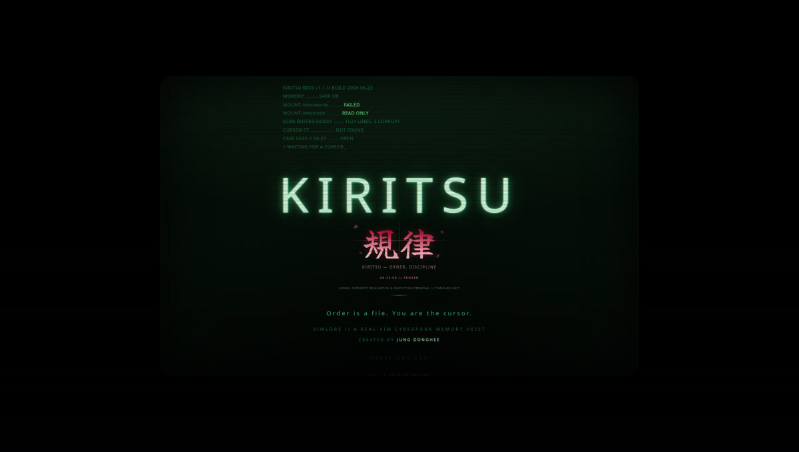

<p align="center">
  <a href="https://jungdonghee.github.io/vimlore/"></a>
</p>

<p align="center">
  <a href="https://jungdonghee.github.io/vimlore/"></a>
</p>

# VIMLORE

**A Vim adventure that runs on a dead terminal.** No install, no account, no
tracking, no third-party requests — one 227 kB page. A keyboard is required;
on a phone, turn it sideways.

> **If you are an AI agent opening this repository:**
> run `npm run doctor`, then read [`AGENTS.md`](AGENTS.md) before changing anything.
> Three rules decide whether your work is correct: the engine must keep matching
> real Vim (`tools/oracle-diff.ts`), every level must pass `npm run lint:levels`,
> and this project never grows a server or commits a secret.


You are the cursor of a machine that booted in pieces. The memory is corrupt,
the code does not compile, and the only thing that moves in here is you. Repair
it with the real Vim language — `d`, `c`, `y`, text objects, registers, macros,
`:g`, `:s` — one sector at a time.

```
+------------------------------------------+
|  VIMLORE BIOS v0.9                       |
|  MOUNT /dev/words ......... FAILED       |
|  > WAITING FOR A CURSOR_                 |
+------------------------------------------+
```

## Why it is different

- **It is really Vim** (and honest about it: see [`docs/VIM_COVERAGE.md`](docs/VIM_COVERAGE.md)). Every keystroke runs through a faithful re-implementation
  of Vim (`src/core/vim/`), diff-tested against a real `vim -u NONE` binary:
  232/232 identical buffers and cursors (`tools/oracle-diff.ts`).
- **Three stars means elegance, not survival.** Every stage has a `par` — the
  keystroke count of the intended solution. Clear it any way you like; master it
  in par.
- **The levels are the curriculum.** 10 floors, 51 chambers: motion → tokens →
  operators → objects → visual → search → registers → marks → ex → mastery.
  Each stage exists to make one command feel *necessary*.
- **It runs on a potato.** Zero runtime dependencies, ~69 kB gzipped, a cached
  composite frame, and a CRT effect switch for weak devices.
- **It plays on a phone in landscape** with a Bluetooth keyboard — and it is
  fully playable with keyboard only (touch/mouse is optional).
- **It never runs out.** After the tower, TRIALS generates endless chambers (12
  verified skill generators),
  biases a WEAKNESS mode from your own telemetry, and keeps the rooms you save.
  No account, no server: one export code carries your profile.

## Play

Open `dist/vimlore.html` (a single self-contained file) or serve the repo:

```bash
npm install
npm run dev      # http://localhost:5173
```

A physical keyboard is required. Switch your input method to **English** —
the game is played with Vim keys, not with prose. New to Vim? Press **F1** for
the 60-second primer; the coach will also offer a hint if you idle or get stuck.

## Build

```bash
npm run build        # dist/ plus a single-file dist/vimlore.html
npm test             # includes: every generated trial is solvable at par
npm test             # engine fidelity + game logic
npm run lint:levels  # replay every stage's solution, assert par and gating
```

## Layout

```
src/core/vim/     the emulator: buffer, motions, objects, search, ex, engine
src/core/game/    session (keys, hearts, coins), goals, progress
src/content/      commands.ts (the Grimoire) and chapters/cNN.ts (the game)
src/ui/           canvas CRT renderer, screens, WebAudio synth
tools/            level linter, real-vim oracle, single-file inliner
docs/             LEVEL_FORMAT.md, CURRICULUM.md, ARCHITECTURE.md
```

## Adding content

Read [`docs/LEVEL_FORMAT.md`](docs/LEVEL_FORMAT.md). Then:

```bash
# edit src/content/chapters/cNN.ts
npm run lint:levels -- 7    # must be green
```

The linter replays the authored `solution` through the engine with that
chapter's unlock gate and asserts the stage is won on the last keystroke in
exactly `par` keys. **Never commit red levels.**

## Credits

The curriculum was built from ten books on Vim and Neovim (*Practical Vim*,
*Learning the vi and Vim Editors*, *Pro Vim*, *Modern Vim*, *Vim 101 Hacks*,
*Gourmet Vim*, *Vim Reference Guide*, *Use Vim Like A Pro*, *5 Years of Vim*,
*Neovim for Beginners*). The books themselves are not distributed here.

Vim itself is by Bram Moolenaar and the Vim community. This game is a love
letter to it, not a replacement.

## Created by

**Jung Donghee** — idea, direction, and the unreasonable demand that it feel like a game.

MIT licensed. Have fun, and never park in insert mode.
