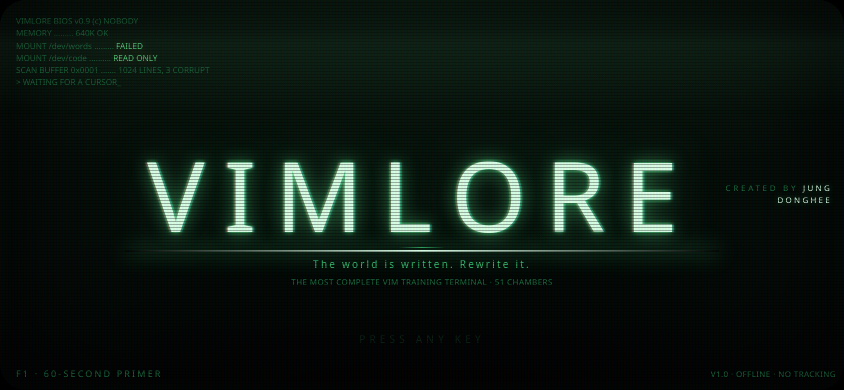
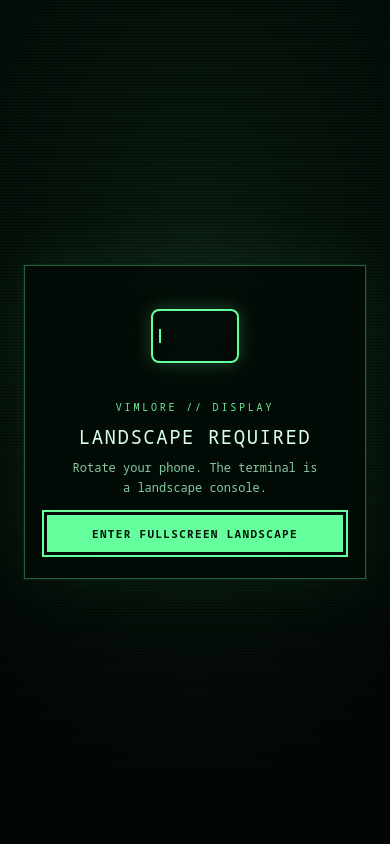

<p align="center">
  <a href="https://jungdonghee.github.io/vimlore/"></a>
</p>

<p align="center">
  <a href="https://jungdonghee.github.io/vimlore/"></a>
</p>

# VIMLORE

**The most complete Vim training terminal ever attempted — a Vim adventure that
runs on a dead terminal.** That is the destination, not a claim about today: the
coverage ledger is public. No install, no account, no tracking, no third-party
requests — one ~278 kB page. A keyboard is required; on a phone, turn it sideways.

> **If you are an AI agent opening this repository:**
> run `npm run doctor`, then read [`AGENTS.md`](AGENTS.md) before changing anything.
> Three rules decide whether your work is correct: the engine must keep matching
> real Vim (`tools/oracle-diff.ts`), every level must pass `npm run lint:levels`,
> and this project never grows a server or commits a secret.


You are the cursor of a machine that booted in pieces. The memory is corrupt,
the code does not compile, and the only thing that moves in here is you. Repair
it with the real Vim language — `d`, `c`, `y`, text objects, registers, macros,
`:g`, `:s` — one sector at a time.

```
+------------------------------------------+
|  VIMLORE BIOS v0.9                       |
|  MOUNT /dev/words ......... FAILED       |
|  > WAITING FOR A CURSOR_                 |
+------------------------------------------+
```

## Current state (2026-11-13)

This is a **development build**, not a finished Vim Adventures peer.

- **Playable core ~90%** — 51 stages, a real Vim engine, installable offline PWA.
- **Full product ~67%** — weighted estimate; see
  [`docs/COMPLETION.md`](docs/COMPLETION.md) for the matrix.
- **Drew Neil curriculum ~32% by tip coverage** — Practical Vim: **48 of 123**
  tips represented; Modern Vim: **0 of 28** playable (deferred honestly).
- **Engine:** 373 of 373 oracle cases and 51 of 51 game-used solutions; full
  state has **119 known edges** and fuzz has **3 visual edges**.
- **Content:** 10 chapters, 51 stages, 88 Grimoire commands; 39 Practical gaps
  are drill candidates and 28 need the deferred files/windows/quickfix surface.

Read [`COMPLETION.md`](docs/COMPLETION.md) and
[`COMPARISON.md`](docs/COMPARISON.md) before calling it complete.

## Why it is different

- **It is really Vim** (and honest about it: see [`docs/VIM_COVERAGE.md`](docs/VIM_COVERAGE.md)). Every keystroke runs through a faithful re-implementation
  of Vim (`src/core/vim/`), diff-tested against a real `vim -u NONE` binary:
  **373 of 373** oracle cases, plus **51 of 51** shipped stage solutions replayed
  in real Vim (`npm run level-oracle`). The game-used solution+undo surface is
  51 of 51; remaining full-editor edge cases are public debt, not hidden.
- **Three stars means elegance, not survival.** Every stage has a `par` — the
  keystroke count of the intended solution. Clear it any way you like; master it
  in par.
- **Drew Neil is the spine.** 10 floors, 51 chambers, with every stage carrying
  an evidence-checked citation to *Practical Vim* (or a named supplement).
  Practical Vim is the playable first book; *Modern Vim* is the deferred second
  book until the engine grows the required editor surface. Coverage gaps are
  public in [`books-index/curriculum-map/GAPS.md`](books-index/curriculum-map/GAPS.md).
- **Bug-resistant by construction.** Real-Vim oracle, stage level-oracle,
  game-used state matrix, per-stage simulation under the real gate, grammar/
  count matrices, seeded differential fuzzing, cross-layer invariants and
  docs/CI/build checks. The fuzz debt that remains is written down, not waived:
  [`docs/FUZZ_DEBT.md`](docs/FUZZ_DEBT.md), [`docs/STATE_DEBT.md`](docs/STATE_DEBT.md).
- **Breadth is the product.** 88 grimoire commands today, 51 chambers, 373
  oracle cases — and **no artificial cap**: motions, operators, text objects,
  registers, macros, marks, search, `:s`/`:g`, undo/jumps, visual/block, ex, and
  eventually buffers/files/splits/tabs are all in scope. Deferred is not
  rejected; the roadmap is [`docs/FUTURE_EDITOR.md`](docs/FUTURE_EDITOR.md).
- **It runs on a potato.** Zero runtime dependencies, a hard
  **278 kB / 87 kB** bundle gate, one canvas with a cached opaque composite
  frame, cursorline/numbers on a cheap FX pass, and a CRT switch for weak
  devices. Current measured: mobile **60.5 FPS**, desktop headless **55.4–57.6 FPS**;
  [BROWSER_QA.md](docs/BROWSER_QA.md). 144fps is not claimed without a 144Hz/GPU
  measurement.
- **It plays on a phone in landscape** with a Bluetooth keyboard — and it is
  fully playable with keyboard only (touch/mouse is optional).
- **It trains for mastery, not just completion.** Par/3-star, best keys, F3
  ghost, GOLF retry over par, TRIALS with weakness/daily selection, and a
  documented introduce → drill → transfer → spaced-review loop. See
  [`docs/MASTERY_VIM_GOLF.md`](docs/MASTERY_VIM_GOLF.md).
- **It never runs out.** After the tower, TRIALS generates endless chambers (12
  verified skill generators), biases a WEAKNESS mode from your own telemetry,
  and keeps the rooms you save. No account, no server: one export code carries
  your profile.

## Screens

| CRT dashboard / landscape title | Portrait landscape gate |
|---|---|
|  |  |

The icon is a large **V built from terminal commands**; see
[`docs/DESIGN.md`](docs/DESIGN.md) and [`public/icons/icon-512.png`](public/icons/icon-512.png).

## Design

A deliberate CRT vector language: the icon is a large **V made of terminal
commands**, with a cursor block at its vertex. Rationale and measurements are
in [`docs/DESIGN.md`](docs/DESIGN.md).

## Compare

How VIMLORE currently stands against Vim Adventures, VimTutor, PacVim, VimHero
and VimGenius — including the honest gaps: [`docs/COMPARISON.md`](docs/COMPARISON.md).

## Install as an app

VIMLORE is installable from Chromium (Chrome/Edge desktop, Chrome Android).
Use the install icon in the address bar, the browser menu, or the in-game
`INSTALL VIMLORE` chip when it appears. Installed, it launches standalone with
the CRT icon and — on Android — the manifest's **landscape** lock. In a normal
portrait browser tab a full-screen rotate gate blocks play; its button requests
fullscreen + landscape lock, otherwise rotate the phone. See
[`docs/PWA.md`](docs/PWA.md) for the exact platform limits and offline cache.

## Play

Open `dist/vimlore.html` (a single self-contained file) or serve the repo:

```bash
npm install
npm run dev      # http://localhost:5173
```

A physical keyboard is required. Switch your input method to **English** —
the game is played with Vim keys, not with prose. New to Vim? Press **F1** for
the 60-second primer; the coach will also offer a hint if you idle or get stuck.

## Build

```bash
npm run build        # dist/ plus a single-file dist/vimlore.html
npm test             # includes: every generated trial is solvable at par
npm test             # engine fidelity + game logic
npm run lint:levels  # replay every stage's solution, assert par and gating
npm run level-oracle # replay every stage solution in real Vim + engine
npm run browser:qa   # headless desktop ghost/performance/screenshots
```

## Layout

```
src/core/vim/     the emulator: buffer, motions, objects, search, ex, engine
src/core/game/    session (keys, hearts, coins), goals, progress
src/content/      commands.ts (the Grimoire) and chapters/cNN.ts (the game)
src/ui/           canvas CRT renderer, screens, WebAudio synth
tools/            level linter, real-vim oracle, single-file inliner
docs/             NORTH_STAR.md, CURRICULUM_SPINE.md, HANDOFF.md, STATE_DEBT.md
```

## Adding content

Read [`docs/LEVEL_FORMAT.md`](docs/LEVEL_FORMAT.md). Then:

```bash
# edit src/content/chapters/cNN.ts
npm run lint:levels -- 7    # must be green
```

The linter replays the authored `solution` through the engine with that
chapter's unlock gate and asserts the stage is won on the last keystroke in
exactly `par` keys. **Never commit red levels.**

## Credits

The curriculum was built from ten books on Vim and Neovim (*Practical Vim*,
*Learning the vi and Vim Editors*, *Pro Vim*, *Modern Vim*, *Vim 101 Hacks*,
*Gourmet Vim*, *Vim Reference Guide*, *Use Vim Like A Pro*, *5 Years of Vim*,
*Neovim for Beginners*). The books themselves are not distributed here.

Vim itself is by Bram Moolenaar and the Vim community. This game is a love
letter to it, not a replacement.

## Created by

**Jung Donghee** — idea, direction, and the unreasonable demand that it feel like a game.

MIT licensed. Have fun, and never park in insert mode.


## Honest current limits

See [`docs/FINAL_REPORT.md`](docs/FINAL_REPORT.md) and
[`docs/NEXT_STEPS.md`](docs/NEXT_STEPS.md). In short: three visual fuzz edge
cases, 119 full-state (non-game-used) edge cases, 75 not-yet-staged Practical
Vim tips, and Modern Vim's deferred editor surface. Do not read the oracle
numbers as a claim of global Vim completeness.
