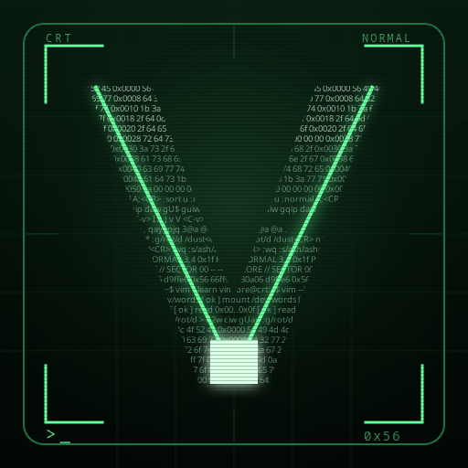
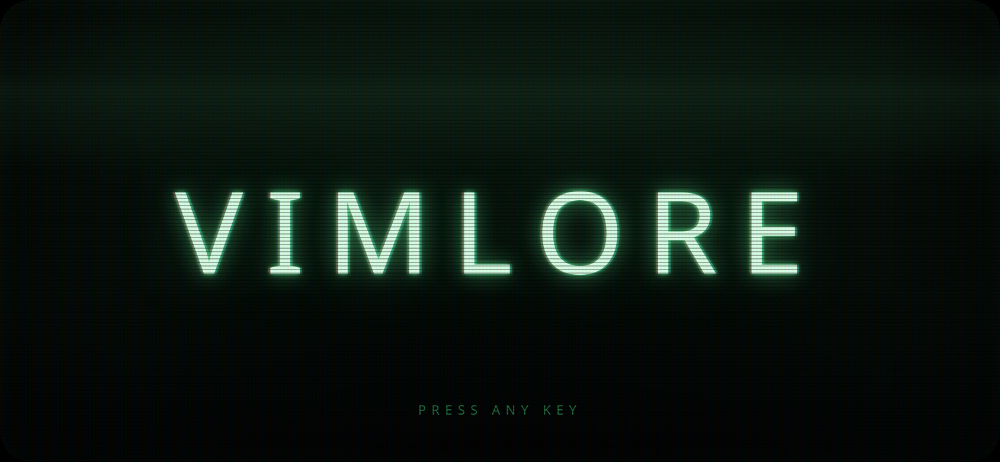

# Design notes — CRT vector / terminal transcript



## The mark

The icon is not a generic letter. The **V is the buffer**: its two arms are a
mask filled with small terminal/Vim commands, hex offsets and status fragments.
The words are deliberately clipped by the letter, so at 512 px you read a
transcript, while at 32/16 px the same pixels resolve into a bright V. The
cursor block sits in the V's vertex: the player is the cursor.

Around it: a thin CRT bezel with four corner rules, a low-contrast vector grid,
`CRT // NORMAL` micro-labels and one phosphor accent. No drop shadows, no
rainbow glitch, no stock futuristic gradients — only the screen, the trace and
the cursor.

The favicon is a reduced cut of the same idea: a brighter V mask with fewer
rows, still built from code.

## Type and scale

- Micro-copy is monospace (`Noto Sans Mono` fallback), tracked wide, all caps.
- The icon's command rows are real Vim fragments (`d2w`, `ciw`, `gUap`,
  `:g/rot/d`, `:s/ash/ashen/g`, `0x56`).
- The V outline is four pixels at 512, so it survives downscaling.
- The master is vector (`public/icons/icon.svg`); PNGs are generated, never
  hand-tweaked. This keeps 192/512/maskable/Apple/favicons consistent.

## Title

`VIMLORE` is horizontally centered by compensating the wordmark's trailing
letter-spacing. Measured center offset: **0.6 px** at 844×390 and **0.9 px** at
1920×1080. On a short landscape phone the bootlog, tagline and footer are
removed so the wordmark sits at the exact viewport center (dx 0.6, dy 0.0) and
`PRESS ANY KEY` becomes the only lower chrome. Nothing overlaps.



## Landscape gate

Portrait touch devices get a full-screen terminal dialog, not a broken
portrait game. It requests fullscreen + `screen.orientation.lock('landscape')`;
the installed app uses the manifest's `orientation: landscape`. See
[`PWA.md`](PWA.md) for the platform limits.

## Regenerate

```bash
npm run pwa:icons   # public/icons/icon.svg -> all PNGs (dev-only Playwright)
npm run pwa:check   # manifest/icons/SW/split (CI)
npm run pwa:qa      # installability 0 errors, gate, offline, centering
```
